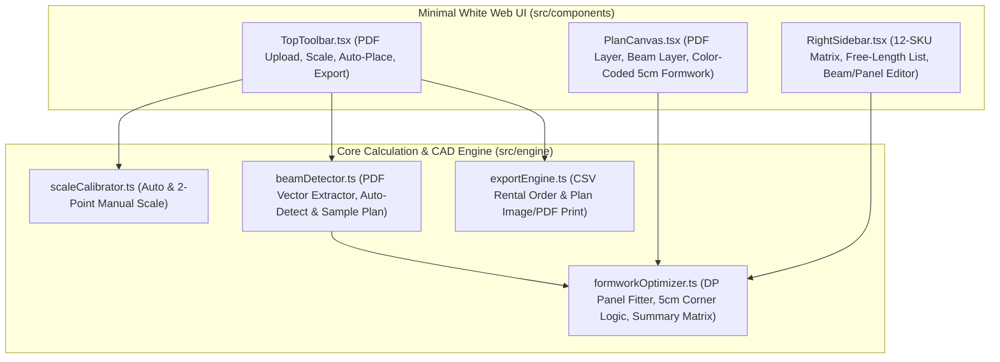

# Modular Beam Formwork Calculator Implementation Plan

> **For agentic workers:** REQUIRED SUB-SKILL: Use superpowers:subagent-driven-development to implement this plan task-by-task. Steps use checkbox (`- [ ]`) syntax for tracking.

**Goal:** Build a Minimal White interactive web application that imports a structural beam plan PDF, calibrates scale (Auto/Manual), detects or draws beams, automatically arranges 2-sided modular rental formwork panels (Lengths: `50, 100, 120 cm` × Heights: `40, 50, 60, 70 cm`, with fixed `5 cm` thickness and free-length filler items), supports interactive post-auto editing, and exports color-coded plans and rental summary tables.

**Architecture:** Pure client-side modular React + TypeScript application structured around a pure functional calculation engine (`src/engine/`) and a clean Minimal White CAD interface (`src/components/`). The engine handles dynamic programming panel optimization, 5 cm corner thickness offsets, scale calibration, and parallel vector beam detection, while the UI provides an HTML5 interactive canvas and a real-time 12-SKU (`3 lengths × 4 heights`) + Free-Length summary and editing sidebar.

**Architecture Diagram:**



**Tech Stack:** React 18, TypeScript, Vite, Tailwind CSS, Vitest, Testing Library, `lucide-react`, `pdfjs-dist`

**Spec:** [2026-10-27-formwork-calculator-design.md](file:///c:/Users/sun-z/OneDrive/AI/%E0%B8%84%E0%B8%B3%E0%B8%99%E0%B8%A7%E0%B8%99%E0%B9%84%E0%B8%A1%E0%B9%89%E0%B9%81%E0%B8%9A%E0%B8%9A/docs/superpowers/specs/2026-10-27-formwork-calculator-design.md)

## Global Constraints

- **Formwork Thickness:** Always fixed at `5 cm` (`FORMWORK_THICKNESS_CM = 5`) in all calculations, corner extensions, and visual renderings.
- **Standard Rental Panel Lengths:** `120 cm`, `100 cm`, `50 cm`.
- **Standard Formwork Heights:** `40 cm`, `50 cm`, `60 cm`, `70 cm` (applicable to every standard length and free-length filler item).
- **Optimization Priority:** Minimize Free-Length remainder ($R = L - \sum \text{standard panels}$) first; tie-break by minimum total panel count (favoring `120 -> 100 -> 50`).
- **Color Coding:** `120 cm` = Emerald (`#10B981`), `100 cm` = Royal Blue (`#3B82F6`), `50 cm` = Amber (`#F59E0B`), `Free Length` = Dashed Rose (`#F43F5E`).
- **UI Aesthetic:** Minimal White (`#FFFFFF` surfaces, `#F8FAFC` canvas wrapper, `#E2E8F0` 1px borders, `#0F172A` slate text).

---

### Task 1: Project Scaffolding, Core Domain Models & DP Formwork Optimizer

**Files:**
- Create: [package.json](file:///c:/Users/sun-z/OneDrive/AI/%E0%B8%84%E0%B8%B3%E0%B8%99%E0%B8%A7%E0%B8%99%E0%B9%84%E0%B8%A1%E0%B9%89%E0%B9%81%E0%B8%9A%E0%B8%9A/package.json)
- Create: [vite.config.ts](file:///c:/Users/sun-z/OneDrive/AI/%E0%B8%84%E0%B8%B3%E0%B8%99%E0%B8%A7%E0%B8%99%E0%B9%84%E0%B8%A1%E0%B9%89%E0%B9%81%E0%B8%9A%E0%B8%9A/vite.config.ts)
- Create: [tsconfig.json](file:///c:/Users/sun-z/OneDrive/AI/%E0%B8%84%E0%B8%B3%E0%B8%99%E0%B8%A7%E0%B8%99%E0%B9%84%E0%B8%A1%E0%B9%89%E0%B9%81%E0%B8%9A%E0%B8%9A/tsconfig.json)
- Create: [index.html](file:///c:/Users/sun-z/OneDrive/AI/%E0%B8%84%E0%B8%B3%E0%B8%99%E0%B8%A7%E0%B8%99%E0%B9%84%E0%B8%A1%E0%B9%89%E0%B9%81%E0%B8%9A%E0%B8%9A/index.html)
- Create: [src/types/formwork.ts](file:///c:/Users/sun-z/OneDrive/AI/%E0%B8%84%E0%B8%B3%E0%B8%99%E0%B8%A7%E0%B8%99%E0%B9%84%E0%B8%A1%E0%B9%89%E0%B9%81%E0%B8%9A%E0%B8%9A/src/types/formwork.ts)
- Create: [src/engine/formworkOptimizer.ts](file:///c:/Users/sun-z/OneDrive/AI/%E0%B8%84%E0%B8%B3%E0%B8%99%E0%B8%A7%E0%B8%99%E0%B9%84%E0%B8%A1%E0%B9%89%E0%B9%81%E0%B8%9A%E0%B8%9A/src/engine/formworkOptimizer.ts)
- Test: [src/engine/__tests__/formworkOptimizer.test.ts](file:///c:/Users/sun-z/OneDrive/AI/%E0%B8%84%E0%B8%B3%E0%B8%99%E0%B8%A7%E0%B8%99%E0%B9%84%E0%B8%A1%E0%B9%89%E0%B9%81%E0%B8%9A%E0%B8%9A/src/engine/__tests__/formworkOptimizer.test.ts)

**Interfaces:**
- Consumes: None (root domain task)
- Produces:
  - `FORMWORK_THICKNESS_CM = 5`
  - `STANDARD_LENGTHS = [120, 100, 50] as const`
  - `FORMWORK_HEIGHTS = [40, 50, 60, 70] as const`
  - `optimizeSingleSidePanels(targetLengthCm: number, heightCm: FormworkHeight, beamId: string, side: 'left' | 'right'): PlacedPanel[]`
  - `applyAutoCornerExtensions(beams: BeamElement[], pixelsPerCm: number): BeamElement[]`
  - `computeAllBeamPanels(beams: BeamElement[], pixelsPerCm: number): PlacedPanel[]`
  - `computeRentalSummary(panels: PlacedPanel[]): RentalSummaryReport`

- [ ] **Step 1: Scaffold Vite + React + TypeScript + Tailwind + Vitest project files**

Create `package.json`, `tsconfig.json`, `vite.config.ts`, `index.html`, and `src/types/formwork.ts`:

```json
// package.json
{
  "name": "modular-formwork-calculator",
  "private": true,
  "version": "1.0.0",
  "type": "module",
  "scripts": {
    "dev": "vite",
    "build": "tsc -b && vite build",
    "test": "vitest run",
    "test:watch": "vitest"
  },
  "dependencies": {
    "lucide-react": "^0.454.0",
    "pdfjs-dist": "^4.7.76",
    "react": "^18.3.1",
    "react-dom": "^18.3.1"
  },
  "devDependencies": {
    "@testing-library/jest-dom": "^6.6.3",
    "@testing-library/react": "^16.0.1",
    "@types/react": "^18.3.12",
    "@types/react-dom": "^18.3.1",
    "@vitejs/plugin-react": "^4.3.3",
    "autoprefixer": "^10.4.20",
    "jsdom": "^25.0.1",
    "postcss": "^8.4.47",
    "tailwindcss": "^3.4.14",
    "typescript": "^5.6.2",
    "vite": "^5.4.10",
    "vitest": "^2.1.4"
  }
}
```

```typescript
// src/types/formwork.ts
export const FORMWORK_THICKNESS_CM = 5 as const;
export const STANDARD_LENGTHS = [120, 100, 50] as const;
export const FORMWORK_HEIGHTS = [40, 50, 60, 70] as const;

export type StandardPanelLength = (typeof STANDARD_LENGTHS)[number];
export type FormworkHeight = (typeof FORMWORK_HEIGHTS)[number];

export interface Point {
  x: number;
  y: number;
}

export interface PlacedPanel {
  id: string;
  beamId: string;
  beamName: string;
  side: 'left' | 'right';
  type: 'standard' | 'free';
  lengthCm: number;
  heightCm: FormworkHeight;
  thicknessCm: 5;
  offsetStartCm: number;
}

export interface BeamSideConfig {
  side: 'left' | 'right';
  heightCm: FormworkHeight;
  startExtensionCm: number; // +5 cm when wrapping outer corner, or 0
  endExtensionCm: number;   // +5 cm when wrapping outer corner, or 0
  customPanels?: PlacedPanel[];
}

export interface BeamElement {
  id: string;
  name: string;
  start: Point;
  end: Point;
  widthCm: number;
  defaultHeightCm: FormworkHeight;
  thicknessCm: 5;
  leftSide: BeamSideConfig;
  rightSide: BeamSideConfig;
}

export interface FreeLengthItemSummary {
  id: string;
  beamName: string;
  side: 'left' | 'right';
  lengthCm: number;
  heightCm: FormworkHeight;
  thicknessCm: 5;
}

export interface RentalSummaryReport {
  // matrix[length][height] = count of panels
  matrix: Record<StandardPanelLength, Record<FormworkHeight, number>>;
  totalsByLength: Record<StandardPanelLength, number>;
  totalsByHeight: Record<FormworkHeight, number>;
  totalStandardPanels: number;
  totalStandardAreaSqm: number;
  freeItems: FreeLengthItemSummary[];
  freeTotalsByHeightCm: Record<FormworkHeight, { count: number; totalLengthCm: number }>;
  totalFreeLengthCm: number;
}
```

- [ ] **Step 2: Write the failing unit tests for `formworkOptimizer`**

Create `src/engine/__tests__/formworkOptimizer.test.ts`:

```typescript
import { describe, it, expect } from 'vitest';
import {
  optimizeSingleSidePanels,
  applyAutoCornerExtensions,
  computeAllBeamPanels,
  computeRentalSummary,
} from '../formworkOptimizer';
import { BeamElement, FORMWORK_THICKNESS_CM } from '../../types/formwork';

describe('formworkOptimizer', () => {
  it('always sets formwork thickness to 5 cm on every generated panel', () => {
    const panels = optimizeSingleSidePanels(220, 60, 'b1', 'B1', 'left');
    expect(panels.every((p) => p.thicknessCm === FORMWORK_THICKNESS_CM)).toBe(true);
    expect(panels.every((p) => p.thicknessCm === 5)).toBe(true);
  });

  it('prefers zero free-length remainder over greedy 120cm (e.g., 300cm -> 100x3 instead of 120x2+50+Free10)', () => {
    const panels = optimizeSingleSidePanels(300, 50, 'b1', 'B1', 'left');
    const lengths = panels.map((p) => p.lengthCm);
    expect(lengths).toEqual([100, 100, 100]);
    expect(panels.some((p) => p.type === 'free')).toBe(false);
  });

  it('minimizes panel count when exact fit is possible (e.g., 270cm -> 120 + 100 + 50)', () => {
    const panels = optimizeSingleSidePanels(270, 40, 'b1', 'B1', 'right');
    expect(panels.map((p) => p.lengthCm)).toEqual([120, 100, 50]);
    expect(panels.every((p) => p.heightCm === 40)).toBe(true);
  });

  it('creates a free-length item with minimized remainder when length cannot be exact (e.g., 285cm -> 120+100+50 + Free 15cm)', () => {
    const panels = optimizeSingleSidePanels(285, 70, 'b1', 'B1', 'left');
    const std = panels.filter((p) => p.type === 'standard').map((p) => p.lengthCm);
    const free = panels.filter((p) => p.type === 'free');
    expect(std).toEqual([120, 100, 50]);
    expect(free).toHaveLength(1);
    expect(free[0].lengthCm).toBe(15);
    expect(free[0].heightCm).toBe(70);
    expect(free[0].thicknessCm).toBe(5);
  });

  it('adds +5 cm outer corner extension when two perpendicular beams meet at an L-corner', () => {
    const beams: BeamElement[] = [
      {
        id: 'b1',
        name: 'B1',
        start: { x: 0, y: 0 },
        end: { x: 400, y: 0 }, // 400 cm at 1 px/cm
        widthCm: 20,
        defaultHeightCm: 60,
        thicknessCm: 5,
        leftSide: { side: 'left', heightCm: 60, startExtensionCm: 0, endExtensionCm: 0 },
        rightSide: { side: 'right', heightCm: 60, startExtensionCm: 0, endExtensionCm: 0 },
      },
      {
        id: 'b2',
        name: 'B2',
        start: { x: 400, y: 0 },
        end: { x: 400, y: 300 },
        widthCm: 20,
        defaultHeightCm: 60,
        thicknessCm: 5,
        leftSide: { side: 'left', heightCm: 60, startExtensionCm: 0, endExtensionCm: 0 },
        rightSide: { side: 'right', heightCm: 60, startExtensionCm: 0, endExtensionCm: 0 },
      },
    ];

    const adjusted = applyAutoCornerExtensions(beams, 1);
    // At the corner (400,0), outer side gets +5 cm formwork thickness extension
    const hasFiveCmExtension =
      adjusted[0].leftSide.endExtensionCm === 5 ||
      adjusted[0].rightSide.endExtensionCm === 5;
    expect(hasFiveCmExtension).toBe(true);
  });

  it('aggregates rental summary across all 12 SKUs (3 lengths x 4 heights) and free-length heights', () => {
    const beams: BeamElement[] = [
      {
        id: 'b1',
        name: 'B1',
        start: { x: 0, y: 0 },
        end: { x: 255, y: 0 }, // 255 cm -> 120 + 100 + Free 35 (or 100+100+50 + Free 5! Wait: 100+100+50=250 -> Free 5!)
        widthCm: 20,
        defaultHeightCm: 40,
        thicknessCm: 5,
        leftSide: { side: 'left', heightCm: 40, startExtensionCm: 0, endExtensionCm: 0 },
        rightSide: { side: 'right', heightCm: 70, startExtensionCm: 0, endExtensionCm: 0 },
      },
    ];
    const panels = computeAllBeamPanels(beams, 1);
    const summary = computeRentalSummary(panels);

    // 255 cm = 100 + 100 + 50 (250 cm) + Free 5 cm on each side!
    expect(summary.matrix[100][40]).toBe(2);
    expect(summary.matrix[50][40]).toBe(1);
    expect(summary.matrix[100][70]).toBe(2);
    expect(summary.matrix[50][70]).toBe(1);
    expect(summary.freeTotalsByHeightCm[40].totalLengthCm).toBe(5);
    expect(summary.freeTotalsByHeightCm[70].totalLengthCm).toBe(5);
  });
});
```

- [ ] **Step 3: Run Vitest to verify tests fail before implementation**

Run: `npm install && npx vitest run src/engine/__tests__/formworkOptimizer.test.ts`
Expected: FAIL with module `../formworkOptimizer` not found.

- [ ] **Step 4: Implement `src/engine/formworkOptimizer.ts`**

Create `src/engine/formworkOptimizer.ts` with dynamic programming optimization for `{120, 100, 50}` panels, fixed `5 cm` formwork thickness, corner detection, and 12-SKU (`{120, 100, 50} × {40, 50, 60, 70}`) summary calculation:

```typescript
import {
  BeamElement,
  FORMWORK_HEIGHTS,
  FORMWORK_THICKNESS_CM,
  FormworkHeight,
  PlacedPanel,
  RentalSummaryReport,
  STANDARD_LENGTHS,
  StandardPanelLength,
} from '../types/formwork';

interface ComboResult {
  counts: Record<StandardPanelLength, number>;
  coveredLength: number;
  remainder: number;
  totalPanels: number;
}

/**
 * Finds the combination of {120, 100, 50} cm panels <= targetLengthCm that:
 * 1. Minimizes the remainder (free length)
 * 2. Tie-breaks by minimum total number of standard panels
 * 3. Tie-breaks by preferring more 120 cm panels, then 100 cm panels
 */
export function findOptimalPanelCombination(targetLengthCm: number): ComboResult {
  const cleanLength = Math.max(0, Math.round(targetLengthCm));
  let best: ComboResult = {
    counts: { 120: 0, 100: 0, 50: 0 },
    coveredLength: 0,
    remainder: cleanLength,
    totalPanels: 0,
  };

  const max120 = Math.floor(cleanLength / 120);
  for (let c120 = max120; c120 >= 0; c120--) {
    const remAfter120 = cleanLength - c120 * 120;
    const max100 = Math.floor(remAfter120 / 100);
    for (let c100 = max100; c100 >= 0; c100--) {
      const remAfter100 = remAfter120 - c100 * 100;
      const c50 = Math.floor(remAfter100 / 50);
      const covered = c120 * 120 + c100 * 100 + c50 * 50;
      const remainder = cleanLength - covered;
      const totalPanels = c120 + c100 + c50;

      const isBetterRemainder = remainder < best.remainder;
      const isSameRemainderFewerPanels =
        remainder === best.remainder && totalPanels < best.totalPanels;
      const isSameRemainderSamePanelsMore120 =
        remainder === best.remainder &&
        totalPanels === best.totalPanels &&
        c120 > best.counts[120];

      if (
        best.coveredLength === 0 && covered > 0 ||
        isBetterRemainder ||
        isSameRemainderFewerPanels ||
        isSameRemainderSamePanelsMore120
      ) {
        best = {
          counts: { 120: c120, 100: c100, 50: c50 },
          coveredLength: covered,
          remainder,
          totalPanels,
        };
      }
    }
  }

  return best;
}

export function optimizeSingleSidePanels(
  targetLengthCm: number,
  heightCm: FormworkHeight,
  beamId: string,
  beamName: string,
  side: 'left' | 'right'
): PlacedPanel[] {
  const cleanLength = Math.max(0, Math.round(targetLengthCm));
  if (cleanLength === 0) return [];

  const combo = findOptimalPanelCombination(cleanLength);
  const panels: PlacedPanel[] = [];
  let offset = 0;
  let index = 1;

  for (const lengthSize of STANDARD_LENGTHS) {
    const count = combo.counts[lengthSize];
    for (let i = 0; i < count; i++) {
      panels.push({
        id: `${beamId}-${side}-std-${index++}`,
        beamId,
        beamName,
        side,
        type: 'standard',
        lengthCm: lengthSize,
        heightCm,
        thicknessCm: FORMWORK_THICKNESS_CM,
        offsetStartCm: offset,
      });
      offset += lengthSize;
    }
  }

  if (combo.remainder > 0) {
    panels.push({
      id: `${beamId}-${side}-free`,
      beamId,
      beamName,
      side,
      type: 'free',
      lengthCm: combo.remainder,
      heightCm,
      thicknessCm: FORMWORK_THICKNESS_CM,
      offsetStartCm: offset,
    });
  }

  return panels;
}

export function getBeamLengthCm(beam: BeamElement, pixelsPerCm: number): number {
  const safeScale = pixelsPerCm > 0 ? pixelsPerCm : 1;
  const dx = beam.end.x - beam.start.x;
  const dy = beam.end.y - beam.start.y;
  return Math.round(Math.hypot(dx, dy) / safeScale);
}

/**
 * Automatically detects L-corners and T-junctions between beams and applies
 * +5 cm (FORMWORK_THICKNESS_CM) on outer corners so the 5 cm formwork wraps cleanly.
 */
export function applyAutoCornerExtensions(
  beams: BeamElement[],
  pixelsPerCm: number
): BeamElement[] {
  const safeScale = pixelsPerCm > 0 ? pixelsPerCm : 1;
  const snapThresholdPx = 25 * safeScale; // within 25 cm

  return beams.map((beam) => {
    let leftStartExt = 0;
    let leftEndExt = 0;
    let rightStartExt = 0;
    let rightEndExt = 0;

    const bDx = beam.end.x - beam.start.x;
    const bDy = beam.end.y - beam.start.y;
    const bLen = Math.hypot(bDx, bDy) || 1;
    const ux = bDx / bLen;
    const uy = bDy / bLen;
    // Left normal (-uy, ux)
    const nx = -uy;
    const ny = ux;

    for (const other of beams) {
      if (other.id === beam.id) continue;

      const oMid = {
        x: (other.start.x + other.end.x) / 2,
        y: (other.start.y + other.end.y) / 2,
      };

      const startDist = Math.min(
        Math.hypot(beam.start.x - other.start.x, beam.start.y - other.start.y),
        Math.hypot(beam.start.x - other.end.x, beam.start.y - other.end.y)
      );
      if (startDist <= snapThresholdPx) {
        const toOtherX = oMid.x - beam.start.x;
        const toOtherY = oMid.y - beam.start.y;
        const dotNormal = toOtherX * nx + toOtherY * ny;
        // Outer side is opposite to the direction the intersecting beam turns
        if (dotNormal >= 0) {
          rightStartExt = FORMWORK_THICKNESS_CM;
        } else {
          leftStartExt = FORMWORK_THICKNESS_CM;
        }
      }

      const endDist = Math.min(
        Math.hypot(beam.end.x - other.start.x, beam.end.y - other.start.y),
        Math.hypot(beam.end.x - other.end.x, beam.end.y - other.end.y)
      );
      if (endDist <= snapThresholdPx) {
        const toOtherX = oMid.x - beam.end.x;
        const toOtherY = oMid.y - beam.end.y;
        const dotNormal = toOtherX * nx + toOtherY * ny;
        if (dotNormal >= 0) {
          rightEndExt = FORMWORK_THICKNESS_CM;
        } else {
          leftEndExt = FORMWORK_THICKNESS_CM;
        }
      }
    }

    return {
      ...beam,
      thicknessCm: FORMWORK_THICKNESS_CM,
      leftSide: {
        ...beam.leftSide,
        startExtensionCm: leftStartExt,
        endExtensionCm: leftEndExt,
      },
      rightSide: {
        ...beam.rightSide,
        startExtensionCm: rightStartExt,
        endExtensionCm: rightEndExt,
      },
    };
  });
}

export function computeAllBeamPanels(
  beams: BeamElement[],
  pixelsPerCm: number
): PlacedPanel[] {
  const allPanels: PlacedPanel[] = [];

  for (const beam of beams) {
    const baseLengthCm = getBeamLengthCm(beam, pixelsPerCm);

    for (const sideKey of ['leftSide', 'rightSide'] as const) {
      const sideCfg = beam[sideKey];
      if (sideCfg.customPanels && sideCfg.customPanels.length > 0) {
        let offset = 0;
        for (const cp of sideCfg.customPanels) {
          allPanels.push({
            ...cp,
            beamId: beam.id,
            beamName: beam.name,
            side: sideCfg.side,
            thicknessCm: FORMWORK_THICKNESS_CM,
            offsetStartCm: offset,
          });
          offset += cp.lengthCm;
        }
      } else {
        const totalSideLengthCm = Math.max(
          0,
          baseLengthCm + sideCfg.startExtensionCm + sideCfg.endExtensionCm
        );
        const sidePanels = optimizeSingleSidePanels(
          totalSideLengthCm,
          sideCfg.heightCm,
          beam.id,
          beam.name,
          sideCfg.side
        );
        allPanels.push(...sidePanels);
      }
    }
  }

  return allPanels;
}

export function computeRentalSummary(panels: PlacedPanel[]): RentalSummaryReport {
  const matrix: Record<StandardPanelLength, Record<FormworkHeight, number>> = {
    120: { 40: 0, 50: 0, 60: 0, 70: 0 },
    100: { 40: 0, 50: 0, 60: 0, 70: 0 },
    50: { 40: 0, 50: 0, 60: 0, 70: 0 },
  };
  const totalsByLength: Record<StandardPanelLength, number> = { 120: 0, 100: 0, 50: 0 };
  const totalsByHeight: Record<FormworkHeight, number> = { 40: 0, 50: 0, 60: 0, 70: 0 };
  const freeTotalsByHeightCm: Record<FormworkHeight, { count: number; totalLengthCm: number }> = {
    40: { count: 0, totalLengthCm: 0 },
    50: { count: 0, totalLengthCm: 0 },
    60: { count: 0, totalLengthCm: 0 },
    70: { count: 0, totalLengthCm: 0 },
  };

  let totalStandardPanels = 0;
  let totalStandardAreaSqm = 0;
  let totalFreeLengthCm = 0;
  const freeItems: RentalSummaryReport['freeItems'] = [];

  for (const panel of panels) {
    const h = FORMWORK_HEIGHTS.includes(panel.heightCm) ? panel.heightCm : 60;
    if (
      panel.type === 'standard' &&
      (panel.lengthCm === 120 || panel.lengthCm === 100 || panel.lengthCm === 50)
    ) {
      matrix[panel.lengthCm][h] += 1;
      totalsByLength[panel.lengthCm] += 1;
      totalsByHeight[h] += 1;
      totalStandardPanels += 1;
      totalStandardAreaSqm += (panel.lengthCm / 100) * (h / 100);
    } else {
      freeItems.push({
        id: panel.id,
        beamName: panel.beamName,
        side: panel.side,
        lengthCm: panel.lengthCm,
        heightCm: h,
        thicknessCm: FORMWORK_THICKNESS_CM,
      });
      freeTotalsByHeightCm[h].count += 1;
      freeTotalsByHeightCm[h].totalLengthCm += panel.lengthCm;
      totalFreeLengthCm += panel.lengthCm;
    }
  }

  return {
    matrix,
    totalsByLength,
    totalsByHeight,
    totalStandardPanels,
    totalStandardAreaSqm: Number(totalStandardAreaSqm.toFixed(2)),
    freeItems,
    freeTotalsByHeightCm,
    totalFreeLengthCm,
  };
}
```

- [ ] **Step 5: Run Vitest and commit Task 1**

Run: `npx vitest run src/engine/__tests__/formworkOptimizer.test.ts`
Expected: PASS (all 6 tests passing)

```bash
git add package.json tsconfig.json vite.config.ts index.html src/types/formwork.ts src/engine/formworkOptimizer.ts src/engine/__tests__/formworkOptimizer.test.ts
git commit -m "feat: add formwork domain models and DP optimization engine with 5cm thickness"
```

---

### Task 2: Scale Calibrator, PDF Vector/Sample Plan Engine & Auto Beam Detector

**Files:**
- Create: [src/engine/scaleCalibrator.ts](file:///c:/Users/sun-z/OneDrive/AI/%E0%B8%84%E0%B8%B3%E0%B8%99%E0%B8%A7%E0%B8%99%E0%B9%84%E0%B8%A1%E0%B9%89%E0%B9%81%E0%B8%9A%E0%B8%9A/src/engine/scaleCalibrator.ts)
- Create: [src/engine/beamDetector.ts](file:///c:/Users/sun-z/OneDrive/AI/%E0%B8%84%E0%B8%B3%E0%B8%99%E0%B8%A7%E0%B8%99%E0%B9%84%E0%B8%A1%E0%B9%89%E0%B9%81%E0%B8%9A%E0%B8%9A/src/engine/beamDetector.ts)
- Test: [src/engine/__tests__/beamAndScale.test.ts](file:///c:/Users/sun-z/OneDrive/AI/%E0%B8%84%E0%B8%B3%E0%B8%99%E0%B8%A7%E0%B8%99%E0%B9%84%E0%B8%A1%E0%B9%89%E0%B9%81%E0%B8%9A%E0%B8%9A/src/engine/__tests__/beamAndScale.test.ts)

**Interfaces:**
- Consumes: `Point`, `BeamElement`, `FormworkHeight`, `FORMWORK_THICKNESS_CM` from `src/types/formwork.ts`
- Produces:
  - `calculateScaleFromTwoPoints(p1: Point, p2: Point, realDistanceCm: number): number`
  - `autoDetectScaleFromPlanData(lines: RawVectorLine[], texts: RawTextItem[]): { pixelsPerCm: number; confidence: string }`
  - `autoDetectBeamsFromVectorLines(lines: RawVectorLine[], pixelsPerCm: number, defaultHeightCm: FormworkHeight): BeamElement[]`
  - `createBeamElement(name: string, start: Point, end: Point, heightCm: FormworkHeight, widthCm?: number): BeamElement`
  - `generateSampleBeamPlan(): { beams: BeamElement[]; pixelsPerCm: number; vectorLines: RawVectorLine[]; texts: RawTextItem[] }`

- [ ] **Step 1: Write the failing unit tests for scale calibration and beam detection**

Create `src/engine/__tests__/beamAndScale.test.ts`:

```typescript
import { describe, it, expect } from 'vitest';
import {
  calculateScaleFromTwoPoints,
  autoDetectScaleFromPlanData,
  RawVectorLine,
  RawTextItem,
} from '../scaleCalibrator';
import {
  autoDetectBeamsFromVectorLines,
  createBeamElement,
  generateSampleBeamPlan,
} from '../beamDetector';

describe('scaleCalibrator & beamDetector', () => {
  it('calculates exact pixelsPerCm from two calibration points and distance in cm', () => {
    const scale = calculateScaleFromTwoPoints({ x: 100, y: 100 }, { x: 500, y: 100 }, 400);
    expect(scale).toBeCloseTo(1.0, 4);
  });

  it('auto-detects scale from dimension text and matching vector line length', () => {
    const lines: RawVectorLine[] = [{ x1: 100, y1: 50, x2: 700, y2: 50 }]; // 600 px
    const texts: RawTextItem[] = [{ text: '4.00', x: 400, y: 45 }]; // 4.00 m = 400 cm -> 1.5 px/cm
    const result = autoDetectScaleFromPlanData(lines, texts);
    expect(result.pixelsPerCm).toBeCloseTo(1.5, 2);
  });

  it('detects parallel horizontal and vertical vector line pairs as beams with 5cm formwork thickness', () => {
    const lines: RawVectorLine[] = [
      // Horizontal beam pair, 20 px apart (20 cm at 1 px/cm), 350 px long
      { x1: 100, y1: 100, x2: 450, y2: 100 },
      { x1: 100, y1: 120, x2: 450, y2: 120 },
      // Vertical beam pair, 20 px apart, 300 px long
      { x1: 100, y1: 120, x2: 100, y2: 420 },
      { x1: 120, y1: 120, x2: 120, y2: 420 },
    ];
    const detected = autoDetectBeamsFromVectorLines(lines, 1.0, 50);
    expect(detected.length).toBe(2);
    expect(detected[0].thicknessCm).toBe(5);
    expect(detected[0].defaultHeightCm).toBe(50);
  });

  it('generates a realistic sample beam plan with multiple heights (40, 50, 60, 70 cm)', () => {
    const sample = generateSampleBeamPlan();
    expect(sample.beams.length).toBeGreaterThanOrEqual(6);
    expect(sample.beams.every((b) => b.thicknessCm === 5)).toBe(true);
    const heights = new Set(sample.beams.map((b) => b.defaultHeightCm));
    expect(heights.size).toBeGreaterThanOrEqual(2);
  });
});
```

- [ ] **Step 2: Run Vitest to verify tests fail**

Run: `npx vitest run src/engine/__tests__/beamAndScale.test.ts`
Expected: FAIL with modules `../scaleCalibrator` and `../beamDetector` not found.

- [ ] **Step 3: Implement `src/engine/scaleCalibrator.ts` and `src/engine/beamDetector.ts`**

Create `src/engine/scaleCalibrator.ts`:

```typescript
import { Point } from '../types/formwork';

export interface RawVectorLine {
  x1: number;
  y1: number;
  x2: number;
  y2: number;
}

export interface RawTextItem {
  text: string;
  x: number;
  y: number;
}

export function calculateScaleFromTwoPoints(
  p1: Point,
  p2: Point,
  realDistanceCm: number
): number {
  const pixelDist = Math.hypot(p2.x - p1.x, p2.y - p1.y);
  if (realDistanceCm <= 0 || pixelDist <= 0) return 1.0;
  return Number((pixelDist / realDistanceCm).toFixed(4));
}

export function autoDetectScaleFromPlanData(
  lines: RawVectorLine[],
  texts: RawTextItem[]
): { pixelsPerCm: number; confidence: string } {
  for (const item of texts) {
    const cleaned = item.text.trim().replace(/,/g, '');
    // Match meters like "4.00", "3.50m", or millimeters/centimeters like "4000", "400"
    const match = cleaned.match(/^(\d+(?:\.\d+)?)\s*(m|cm|mm)?$/i);
    if (!match) continue;

    const rawVal = parseFloat(match[1]);
    const unit = (match[2] || '').toLowerCase();
    let lengthCm = 0;

    if (unit === 'm' || (cleaned.includes('.') && rawVal >= 1 && rawVal <= 20)) {
      lengthCm = rawVal * 100;
    } else if (unit === 'mm' || rawVal >= 1000) {
      lengthCm = rawVal / 10;
    } else if (rawVal >= 50 && rawVal < 1000) {
      lengthCm = rawVal;
    }

    if (lengthCm < 50) continue;

    // Find nearest horizontal or vertical line of plausible pixel length
    let bestLine: RawVectorLine | null = null;
    let bestDist = Infinity;

    for (const line of lines) {
      const pxLen = Math.hypot(line.x2 - line.x1, line.y2 - line.y1);
      if (pxLen < 40) continue;
      const midX = (line.x1 + line.x2) / 2;
      const midY = (line.y1 + line.y2) / 2;
      const dist = Math.hypot(item.x - midX, item.y - midY);
      if (dist < 120 && dist < bestDist) {
        bestDist = dist;
        bestLine = line;
      }
    }

    if (bestLine) {
      const pxLen = Math.hypot(bestLine.x2 - bestLine.x1, bestLine.y2 - bestLine.y1);
      const scale = Number((pxLen / lengthCm).toFixed(4));
      if (scale >= 0.1 && scale <= 10) {
        return {
          pixelsPerCm: scale,
          confidence: `ตรวจพบเส้นบอกระยะ ${item.text} (${lengthCm} ซม.) อัตโนมัติ`,
        };
      }
    }
  }

  return {
    pixelsPerCm: 1.5,
    confidence: 'สเกลเริ่มต้นมาตรฐาน 1:100 (1.5 px/ซม.)',
  };
}
```

Create `src/engine/beamDetector.ts`:

```typescript
import {
  BeamElement,
  FORMWORK_THICKNESS_CM,
  FormworkHeight,
  Point,
} from '../types/formwork';
import { RawTextItem, RawVectorLine } from './scaleCalibrator';

let beamCounter = 1;

export function createBeamElement(
  name: string,
  start: Point,
  end: Point,
  heightCm: FormworkHeight = 60,
  widthCm = 20
): BeamElement {
  const id = `beam-${Date.now()}-${beamCounter++}`;
  return {
    id,
    name,
    start,
    end,
    widthCm,
    defaultHeightCm: heightCm,
    thicknessCm: FORMWORK_THICKNESS_CM,
    leftSide: {
      side: 'left',
      heightCm,
      startExtensionCm: 0,
      endExtensionCm: 0,
    },
    rightSide: {
      side: 'right',
      heightCm,
      startExtensionCm: 0,
      endExtensionCm: 0,
    },
  };
}

export function autoDetectBeamsFromVectorLines(
  lines: RawVectorLine[],
  pixelsPerCm: number,
  defaultHeightCm: FormworkHeight = 60
): BeamElement[] {
  const safeScale = pixelsPerCm > 0 ? pixelsPerCm : 1;
  const minWidthPx = 12 * safeScale;
  const maxWidthPx = 45 * safeScale;
  const minLengthPx = 60 * safeScale;

  const usedIndices = new Set<number>();
  const beams: BeamElement[] = [];
  let indexCounter = 1;

  for (let i = 0; i < lines.length; i++) {
    if (usedIndices.has(i)) continue;
    const l1 = lines[i];
    const len1 = Math.hypot(l1.x2 - l1.x1, l1.y2 - l1.y1);
    if (len1 < minLengthPx) continue;

    const isHoriz1 = Math.abs(l1.y2 - l1.y1) <= Math.abs(l1.x2 - l1.x1) * 0.15;
    const isVert1 = Math.abs(l1.x2 - l1.x1) <= Math.abs(l1.y2 - l1.y1) * 0.15;
    if (!isHoriz1 && !isVert1) continue;

    for (let j = i + 1; j < lines.length; j++) {
      if (usedIndices.has(j)) continue;
      const l2 = lines[j];
      const len2 = Math.hypot(l2.x2 - l2.x1, l2.y2 - l2.y1);
      if (len2 < minLengthPx) continue;

      if (isHoriz1) {
        const isHoriz2 = Math.abs(l2.y2 - l2.y1) <= Math.abs(l2.x2 - l2.x1) * 0.15;
        if (!isHoriz2) continue;
        const y1 = (l1.y1 + l1.y2) / 2;
        const y2 = (l2.y1 + l2.y2) / 2;
        const gapPx = Math.abs(y1 - y2);
        const minX1 = Math.min(l1.x1, l1.x2);
        const maxX1 = Math.max(l1.x1, l1.x2);
        const minX2 = Math.min(l2.x1, l2.x2);
        const maxX2 = Math.max(l2.x1, l2.x2);
        const overlap = Math.min(maxX1, maxX2) - Math.max(minX1, minX2);

        if (gapPx >= minWidthPx && gapPx <= maxWidthPx && overlap >= minLengthPx * 0.7) {
          usedIndices.add(i);
          usedIndices.add(j);
          const midY = (y1 + y2) / 2;
          const startX = Math.max(minX1, minX2);
          const endX = Math.min(maxX1, maxX2);
          const widthCm = Math.round(gapPx / safeScale);
          beams.push(
            createBeamElement(
              `B${indexCounter++}`,
              { x: startX, y: midY },
              { x: endX, y: midY },
              defaultHeightCm,
              widthCm
            )
          );
          break;
        }
      } else if (isVert1) {
        const isVert2 = Math.abs(l2.x2 - l2.x1) <= Math.abs(l2.y2 - l2.y1) * 0.15;
        if (!isVert2) continue;
        const x1 = (l1.x1 + l1.x2) / 2;
        const x2 = (l2.x1 + l2.x2) / 2;
        const gapPx = Math.abs(x1 - x2);
        const minY1 = Math.min(l1.y1, l1.y2);
        const maxY1 = Math.max(l1.y1, l1.y2);
        const minY2 = Math.min(l2.y1, l2.y2);
        const maxY2 = Math.max(l2.y1, l2.y2);
        const overlap = Math.min(maxY1, maxY2) - Math.max(minY1, minY2);

        if (gapPx >= minWidthPx && gapPx <= maxWidthPx && overlap >= minLengthPx * 0.7) {
          usedIndices.add(i);
          usedIndices.add(j);
          const midX = (x1 + x2) / 2;
          const startY = Math.max(minY1, minY2);
          const endY = Math.min(maxY1, maxY2);
          const widthCm = Math.round(gapPx / safeScale);
          beams.push(
            createBeamElement(
              `B${indexCounter++}`,
              { x: midX, y: startY },
              { x: midX, y: endY },
              defaultHeightCm,
              widthCm
            )
          );
          break;
        }
      }
    }
  }

  return beams;
}

export function generateSampleBeamPlan(): {
  beams: BeamElement[];
  pixelsPerCm: number;
  vectorLines: RawVectorLine[];
  texts: RawTextItem[];
} {
  const pixelsPerCm = 1.2; // 1 cm = 1.2 px
  // 2-bay structural floor beam plan:
  // Bay X1: 400 cm (480 px), Bay X2: 350 cm (420 px)
  // Bay Y1: 300 cm (360 px)
  const x0 = 120;
  const x1 = x0 + 400 * pixelsPerCm; // 600
  const x2 = x1 + 350 * pixelsPerCm; // 1020
  const y0 = 120;
  const y1 = y0 + 300 * pixelsPerCm; // 480

  const beams: BeamElement[] = [
    createBeamElement('B1 (บนซ้าย)', { x: x0, y: y0 }, { x: x1, y: y0 }, 60, 20),
    createBeamElement('B2 (บนขวา)', { x: x1, y: y0 }, { x: x2, y: y0 }, 60, 20),
    createBeamElement('B3 (ล่างซ้าย)', { x: x0, y: y1 }, { x: x1, y: y1 }, 50, 20),
    createBeamElement('B4 (ล่างขวา)', { x: x1, y: y1 }, { x: x2, y: y1 }, 50, 20),
    createBeamElement('B5 (ซ้ายสุด)', { x: x0, y: y0 }, { x: x0, y: y1 }, 70, 20),
    createBeamElement('B6 (คานกลาง)', { x: x1, y: y0 }, { x: x1, y: y1 }, 60, 20),
    createBeamElement('B7 (ขวาสุด)', { x: x2, y: y0 }, { x: x2, y: y1 }, 40, 20),
  ];

  const halfW = 10 * pixelsPerCm;
  const vectorLines: RawVectorLine[] = [
    // Dimension reference line for 4.00 m
    { x1: x0, y1: y0 - 45, x2: x1, y2: y0 - 45 },
    { x1: x1, y1: y0 - 45, x2: x2, y2: y0 - 45 },
  ];

  for (const b of beams) {
    const isH = Math.abs(b.end.y - b.start.y) < 1;
    if (isH) {
      vectorLines.push(
        { x1: b.start.x, y1: b.start.y - halfW, x2: b.end.x, y2: b.end.y - halfW },
        { x1: b.start.x, y1: b.start.y + halfW, x2: b.end.x, y2: b.end.y + halfW }
      );
    } else {
      vectorLines.push(
        { x1: b.start.x - halfW, y1: b.start.y, x2: b.end.x - halfW, y2: b.end.y },
        { x1: b.start.x + halfW, y1: b.start.y, x2: b.end.x + halfW, y2: b.end.y }
      );
    }
  }

  const texts: RawTextItem[] = [
    { text: '4.00', x: (x0 + x1) / 2, y: y0 - 52 },
    { text: '3.50', x: (x1 + x2) / 2, y: y0 - 52 },
    { text: '3.00', x: x0 - 55, y: (y0 + y1) / 2 },
  ];

  return { beams, pixelsPerCm, vectorLines, texts };
}
```

- [ ] **Step 4: Run Vitest and commit Task 2**

Run: `npx vitest run src/engine/__tests__/beamAndScale.test.ts`
Expected: PASS (all 4 tests passing)

```bash
git add src/engine/scaleCalibrator.ts src/engine/beamDetector.ts src/engine/__tests__/beamAndScale.test.ts
git commit -m "feat: add scale calibrator, vector beam detector, and sample beam plan generator"
```

---

### Task 3: Export Engine (CSV Rental Order & Plan Image/PDF Exporter)

**Files:**
- Create: [src/engine/exportEngine.ts](file:///c:/Users/sun-z/OneDrive/AI/%E0%B8%84%E0%B8%B3%E0%B8%99%E0%B8%A7%E0%B8%99%E0%B9%84%E0%B8%A1%E0%B9%89%E0%B9%81%E0%B8%9A%E0%B8%9A/src/engine/exportEngine.ts)
- Test: [src/engine/__tests__/exportEngine.test.ts](file:///c:/Users/sun-z/OneDrive/AI/%E0%B8%84%E0%B8%B3%E0%B8%99%E0%B8%A7%E0%B8%99%E0%B9%84%E0%B8%A1%E0%B9%89%E0%B9%81%E0%B8%9A%E0%B8%9A/src/engine/__tests__/exportEngine.test.ts)

**Interfaces:**
- Consumes: `RentalSummaryReport`, `FORMWORK_HEIGHTS`, `STANDARD_LENGTHS`, `FORMWORK_THICKNESS_CM` from `src/types/formwork.ts`
- Produces:
  - `generateRentalSummaryCsv(summary: RentalSummaryReport): string`
  - `downloadCsvFile(csvContent: string, filename?: string): void`
  - `exportCanvasAsPng(canvas: HTMLCanvasElement, filename?: string): void`

- [ ] **Step 1: Write the failing unit tests for `exportEngine`**

Create `src/engine/__tests__/exportEngine.test.ts`:

```typescript
import { describe, it, expect } from 'vitest';
import { computeRentalSummary, optimizeSingleSidePanels } from '../formworkOptimizer';
import { generateRentalSummaryCsv } from '../exportEngine';

describe('exportEngine', () => {
  it('generates UTF-8 BOM CSV with 3 lengths x 4 heights matrix, 5cm thickness, and free-length items', () => {
    const p1 = optimizeSingleSidePanels(285, 60, 'b1', 'B1', 'left');
    const p2 = optimizeSingleSidePanels(240, 40, 'b2', 'B2', 'right');
    const summary = computeRentalSummary([...p1, ...p2]);

    const csv = generateRentalSummaryCsv(summary);
    expect(csv).toContain('ความหนาไม้แบบมาตรฐาน,5 ซม.');
    expect(csv).toContain('120 ซม.,2,0,1,0,3');
    expect(csv).toContain('100 ซม.,0,0,1,0,1');
    expect(csv).toContain('50 ซม.,0,0,1,0,1');
    expect(csv).toContain('B1,ซ้าย,15,60,5');
  });
});
```

- [ ] **Step 2: Run Vitest to verify test fails**

Run: `npx vitest run src/engine/__tests__/exportEngine.test.ts`
Expected: FAIL with module `../exportEngine` not found.

- [ ] **Step 3: Implement `src/engine/exportEngine.ts`**

Create `src/engine/exportEngine.ts`:

```typescript
import {
  FORMWORK_HEIGHTS,
  FORMWORK_THICKNESS_CM,
  RentalSummaryReport,
  STANDARD_LENGTHS,
} from '../types/formwork';

export function generateRentalSummaryCsv(summary: RentalSummaryReport): string {
  const lines: string[] = [];
  lines.push('ตารางสรุปจำนวนไม้แบบสำเร็จรูปสำหรับเช่า (Modular Beam Formwork Summary)');
  lines.push(`ความหนาไม้แบบมาตรฐาน,${FORMWORK_THICKNESS_CM} ซม. ทุกกรณี`);
  lines.push('');
  lines.push(
    'ความยาวมาตรฐาน / ความสูง,สูง 40 ซม. (แผ่น),สูง 50 ซม. (แผ่น),สูง 60 ซม. (แผ่น),สูง 70 ซม. (แผ่น),รวมทั้งหมด (แผ่น)'
  );

  for (const len of STANDARD_LENGTHS) {
    const row = FORMWORK_HEIGHTS.map((h) => summary.matrix[len][h]);
    lines.push(`${len} ซม.,${row.join(',')},${summary.totalsByLength[len]}`);
  }

  const heightSums = FORMWORK_HEIGHTS.map((h) => summary.totalsByHeight[h]);
  lines.push(`รวมตามความสูง (แผ่น),${heightSums.join(',')},${summary.totalStandardPanels}`);
  lines.push(`พื้นที่ไม้แบบเช่ารวม (ตร.ม.),${summary.totalStandardAreaSqm}`);
  lines.push('');
  lines.push('รายการระยะความยาวฟรี (ไม้ตัดเสริมหน้างาน)');
  lines.push('ชื่อคาน,ฝั่งคาน,ความยาวฟรี (ซม.),ความสูง (ซม.),ความหนา (ซม.)');

  for (const item of summary.freeItems) {
    const sideLabel = item.side === 'left' ? 'ซ้าย' : 'ขวา';
    lines.push(
      `${item.beamName},${sideLabel},${item.lengthCm},${item.heightCm},${item.thicknessCm}`
    );
  }

  lines.push(`รวมความยาวฟรีทั้งหมด (ซม.),${summary.totalFreeLengthCm}`);
  return '\uFEFF' + lines.join('\n');
}

export function downloadCsvFile(
  csvContent: string,
  filename = 'formwork-rental-summary.csv'
): void {
  const blob = new Blob([csvContent], { type: 'text/csv;charset=utf-8;' });
  const url = URL.createObjectURL(blob);
  const link = document.createElement('a');
  link.href = url;
  link.setAttribute('download', filename);
  document.body.appendChild(link);
  link.click();
  document.body.removeChild(link);
  URL.revokeObjectURL(url);
}

export function exportCanvasAsPng(
  canvas: HTMLCanvasElement | null,
  filename = 'formwork-layout-plan.png'
): void {
  if (!canvas) return;
  const dataUrl = canvas.toDataURL('image/png');
  const link = document.createElement('a');
  link.href = dataUrl;
  link.setAttribute('download', filename);
  document.body.appendChild(link);
  link.click();
  document.body.removeChild(link);
}
```

- [ ] **Step 4: Run Vitest and commit Task 3**

Run: `npx vitest run src/engine/__tests__/exportEngine.test.ts`
Expected: PASS

```bash
git add src/engine/exportEngine.ts src/engine/__tests__/exportEngine.test.ts
git commit -m "feat: add CSV rental summary and PNG layout plan export engine"
```

---

### Task 4: Minimal White UI — Interactive CAD Canvas, Top Toolbar, 12-SKU Matrix & Beam Editor

**Files:**
- Create: [src/index.css](file:///c:/Users/sun-z/OneDrive/AI/%E0%B8%84%E0%B8%B3%E0%B8%99%E0%B8%A7%E0%B8%99%E0%B9%84%E0%B8%A1%E0%B9%89%E0%B9%81%E0%B8%9A%E0%B8%9A/src/index.css)
- Create: [tailwind.config.js](file:///c:/Users/sun-z/OneDrive/AI/%E0%B8%84%E0%B8%B3%E0%B8%99%E0%B8%A7%E0%B8%99%E0%B9%84%E0%B8%A1%E0%B9%89%E0%B9%81%E0%B8%9A%E0%B8%9A/tailwind.config.js)
- Create: [postcss.config.js](file:///c:/Users/sun-z/OneDrive/AI/%E0%B8%84%E0%B8%B3%E0%B8%99%E0%B8%A7%E0%B8%99%E0%B9%84%E0%B8%A1%E0%B9%89%E0%B9%81%E0%B8%9A%E0%B8%9A/postcss.config.js)
- Create: [src/utils/pdfLoader.ts](file:///c:/Users/sun-z/OneDrive/AI/%E0%B8%84%E0%B8%B3%E0%B8%99%E0%B8%A7%E0%B8%99%E0%B9%84%E0%B8%A1%E0%B9%89%E0%B9%81%E0%B8%9A%E0%B8%9A/src/utils/pdfLoader.ts)
- Create: [src/components/TopToolbar.tsx](file:///c:/Users/sun-z/OneDrive/AI/%E0%B8%84%E0%B8%B3%E0%B8%99%E0%B8%A7%E0%B8%99%E0%B9%84%E0%B8%A1%E0%B9%89%E0%B9%81%E0%B8%9A%E0%B8%9A/src/components/TopToolbar.tsx)
- Create: [src/components/PlanCanvas.tsx](file:///c:/Users/sun-z/OneDrive/AI/%E0%B8%84%E0%B8%B3%E0%B8%99%E0%B8%A7%E0%B8%99%E0%B9%84%E0%B8%A1%E0%B9%89%E0%B9%81%E0%B8%9A%E0%B8%9A/src/components/PlanCanvas.tsx)
- Create: [src/components/RightSidebar.tsx](file:///c:/Users/sun-z/OneDrive/AI/%E0%B8%84%E0%B8%B3%E0%B8%99%E0%B8%A7%E0%B8%99%E0%B9%84%E0%B8%A1%E0%B9%89%E0%B9%81%E0%B8%9A%E0%B8%9A/src/components/RightSidebar.tsx)
- Create: [src/App.tsx](file:///c:/Users/sun-z/OneDrive/AI/%E0%B8%84%E0%B8%B3%E0%B8%99%E0%B8%A7%E0%B8%99%E0%B9%84%E0%B8%A1%E0%B9%89%E0%B9%81%E0%B8%9A%E0%B8%9A/src/App.tsx)
- Create: [src/main.tsx](file:///c:/Users/sun-z/OneDrive/AI/%E0%B8%84%E0%B8%B3%E0%B8%99%E0%B8%A7%E0%B8%99%E0%B9%84%E0%B8%A1%E0%B9%89%E0%B9%81%E0%B8%9A%E0%B8%9A/src/main.tsx)
- Test: [src/__tests__/App.test.tsx](file:///c:/Users/sun-z/OneDrive/AI/%E0%B8%84%E0%B8%B3%E0%B8%99%E0%B8%A7%E0%B8%99%E0%B9%84%E0%B8%A1%E0%B9%89%E0%B9%81%E0%B8%9A%E0%B8%9A/src/__tests__/App.test.tsx)

**Interfaces:**
- Consumes: All functions and types from `src/types/formwork.ts`, `src/engine/formworkOptimizer.ts`, `src/engine/scaleCalibrator.ts`, `src/engine/beamDetector.ts`, and `src/engine/exportEngine.ts`.
- Produces: Complete Minimal White interactive web application (`App` component) with PDF import, Auto/Manual scale, Auto-Detect & Place Formwork, Interactive Canvas, 12-SKU Matrix Summary, Free-Length Summary, and Beam/Panel Editing.

- [ ] **Step 1: Write the failing UI integration tests in `src/__tests__/App.test.tsx`**

Create `src/__tests__/App.test.tsx`:

```tsx
import { describe, it, expect } from 'vitest';
import { render, screen, fireEvent } from '@testing-library/react';
import '@testing-library/jest-dom';
import App from '../App';

describe('App Integration - Minimal White Formwork Calculator', () => {
  it('renders the Minimal White interface with 12-SKU matrix (lengths 120, 100, 50 x heights 40, 50, 60, 70) and fixed 5cm thickness', () => {
    render(<App />);
    expect(screen.getByText(/ความหนาไม้แบบ 5 ซม./i)).toBeInTheDocument();
    expect(screen.getByText('สูง 40 ซม.')).toBeInTheDocument();
    expect(screen.getByText('สูง 50 ซม.')).toBeInTheDocument();
    expect(screen.getByText('สูง 60 ซม.')).toBeInTheDocument();
    expect(screen.getByText('สูง 70 ซม.')).toBeInTheDocument();
    expect(screen.getByText('120 ซม.')).toBeInTheDocument();
    expect(screen.getByText('100 ซม.')).toBeInTheDocument();
    expect(screen.getByText('50 ซม.')).toBeInTheDocument();
  });

  it('allows selecting a beam and editing its formwork height (40, 50, 60, 70 cm) and custom panels', () => {
    render(<App />);
    const beamButton = screen.getByRole('button', { name: /B1 \(บนซ้าย\)/i });
    fireEvent.click(beamButton);

    expect(screen.getByText(/แก้ไขคานและแผ่นไม้แบบ/i)).toBeInTheDocument();
    const height40Btn = screen.getByRole('button', { name: /ตั้งความสูงทั้งสองฝั่ง 40 ซม./i });
    fireEvent.click(height40Btn);

    expect(screen.getAllByText(/40 ซม./i).length).toBeGreaterThan(1);
  });
});
```

- [ ] **Step 2: Run Vitest to verify `App.test.tsx` fails**

Run: `npx vitest run src/__tests__/App.test.tsx`
Expected: FAIL with module `../App` not found.

- [ ] **Step 3: Implement PDF Loader, TopToolbar, PlanCanvas, RightSidebar, and App**

Create `src/utils/pdfLoader.ts` to extract rendered image, vector lines, and text items from an uploaded PDF file using `pdfjs-dist`:

```typescript
import { RawTextItem, RawVectorLine } from '../engine/scaleCalibrator';

export interface LoadedPdfPlan {
  imageDataUrl: string;
  width: number;
  height: number;
  vectorLines: RawVectorLine[];
  texts: RawTextItem[];
}

export async function loadPdfFirstPage(file: File): Promise<LoadedPdfPlan> {
  const pdfjsLib = await import('pdfjs-dist');
  pdfjsLib.GlobalWorkerOptions.workerSrc = `https://cdnjs.cloudflare.com/ajax/libs/pdf.js/${pdfjsLib.version}/pdf.worker.min.mjs`;

  const arrayBuffer = await file.arrayBuffer();
  const pdf = await pdfjsLib.getDocument({ data: arrayBuffer }).promise;
  const page = await pdf.getPage(1);
  const viewport = page.getViewport({ scale: 1.5 });

  const offscreen = document.createElement('canvas');
  offscreen.width = viewport.width;
  offscreen.height = viewport.height;
  const ctx = offscreen.getContext('2d');
  if (ctx) {
    await page.render({ canvasContext: ctx, viewport }).promise;
  }

  const textContent = await page.getTextContent();
  const texts: RawTextItem[] = [];
  for (const item of textContent.items) {
    if ('str' in item && item.str.trim()) {
      const tx = viewport.convertToViewportPoint(item.transform[4], item.transform[5]);
      texts.push({ text: item.str.trim(), x: tx[0], y: tx[1] });
    }
  }

  return {
    imageDataUrl: offscreen.toDataURL('image/png'),
    width: viewport.width,
    height: viewport.height,
    vectorLines: [],
    texts,
  };
}
```

Create `src/components/TopToolbar.tsx`, `src/components/PlanCanvas.tsx`, `src/components/RightSidebar.tsx`, and `src/App.tsx` implementing:
- **TopToolbar:** Upload PDF button, Load Sample Plan button, Scale Mode toggle (`Auto Scale` / `Manual Scale 2 จุด`), Default Formwork Height selector (`40 / 50 / 60 / 70 ซม.`), Tool mode (`เลือก/แก้ไขคาน`, `วาดคานเพิ่ม`), `ออโต้ใส่ไม้แบบ + คิดมุมหนา 5 ซม.` action button, Fixed `ความหนาไม้แบบ 5 ซม.` indicator badge, and `Export PNG` / `Export CSV` buttons.
- **PlanCanvas:** HTML5 Canvas + SVG overlay supporting Zoom/Pan, rendering PDF or blueprint grid, beams with width, and 2-sided formwork panels rendered with true `5 cm` scaled thickness, color-coded (`#10B981` for `120 ซม.`, `#3B82F6` for `100 ซม.`, `#F59E0B` for `50 ซม.`, `#F43F5E` dashed for `ความยาวฟรี`), showing `ยาว×สูง` label on each panel, plus interactive 2-point manual scale calibration and click-to-draw beam mode.
- **RightSidebar:**
  1. **ตารางสรุปจำนวนแบบที่เช่า (12-SKU Matrix):** Rows `120 ซม.`, `100 ซม.`, `50 ซม.` × Columns `สูง 40 ซม.`, `สูง 50 ซม.`, `สูง 60 ซม.`, `สูง 70 ซม.` + Row/Column totals + Total Area (ตร.ม.).
  2. **สรุประยะความยาวฟรี (ไม้ตัดเสริม):** Summary by height (`40, 50, 60, 70 ซม.`) and itemized list showing Beam Name, Side, Free Length (cm), Height (cm), and fixed `5 cm` thickness.
  3. **แก้ไขคานและแผ่นไม้แบบ (Interactive Beam & Panel Editor):** Quick-select beam buttons, edit beam name, width, set both sides or individual side height (`40, 50, 60, 70 ซม.`), toggle `+5 ซม. อมมุมนอก` at start/end of each side, add/remove/replace individual panels (`120`, `100`, `50`, or custom `Free`), and `คำนวณออโต้ใหม่ (Reset Auto)` button.

- [ ] **Step 4: Run all Vitest tests and production build**

Run: `npx vitest run && npm run build`
Expected: PASS (all unit and integration tests pass, TypeScript & Vite build succeeds with zero errors).

- [ ] **Step 5: Commit Task 4**

```bash
git add tailwind.config.js postcss.config.js src/
git commit -m "feat: implement Minimal White CAD UI, interactive canvas, 12-SKU matrix, and beam editor"
```
